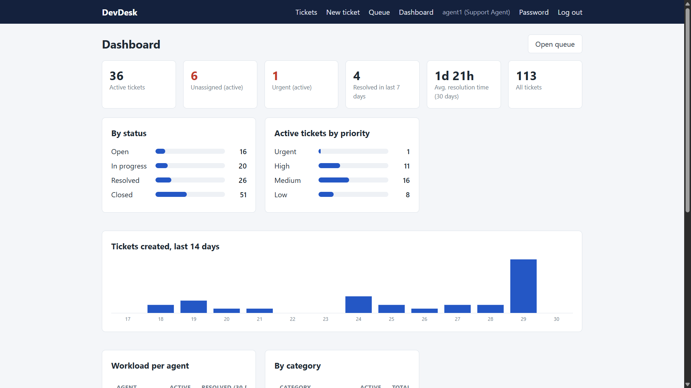
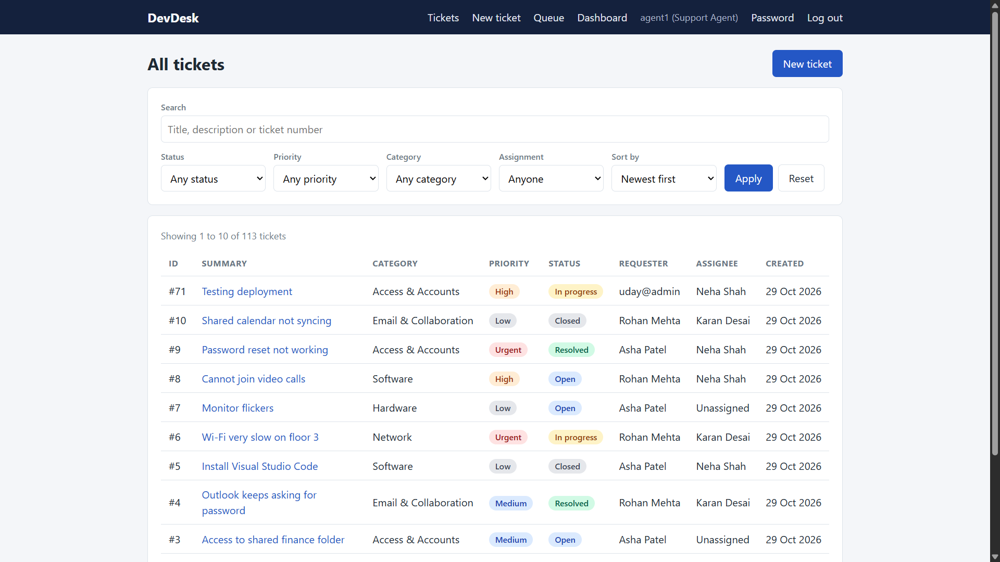
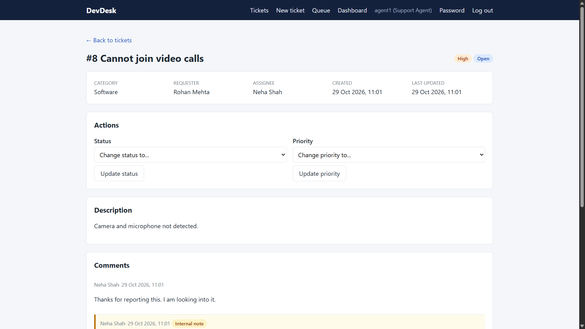
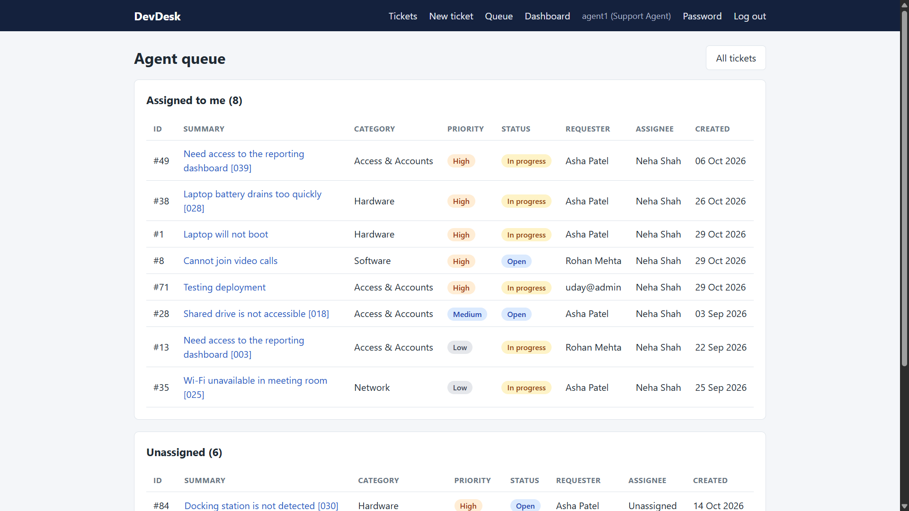
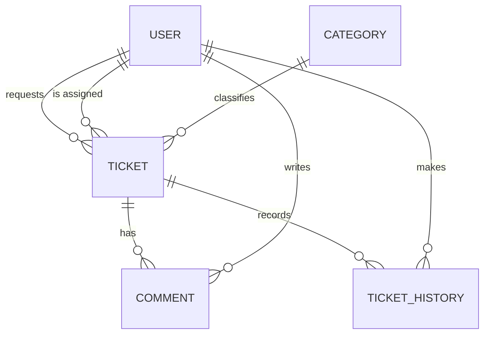

# DevDesk: IT Service & Incident Management System

A help-desk application where employees report IT problems and support agents work them through to resolution. Built with Django and PostgreSQL, with server-side rendering and vanilla JavaScript.

**Live demo:** https://dev-desk.onrender.com/
(Free hosting: the first load after a quiet period can take about a minute.)

| Role          | Username      | Password              |
| ------------- | ------------- | --------------------- |
| Employee      | `employee1` | `DevDesk-demo-123!` |
| Support agent | `agent1`    | `DevDesk-demo-123!` |
| Administrator | `admin1`    | `DevDesk-demo-123!` |

These are public demo accounts on sample data



|                                                  |                                                      |
| ------------------------------------------------ | ---------------------------------------------------- |
|  |  |
|        |

## Features

- **Three roles:** employees, support agents, administrators, with server side authorization on every page and action.
- **Ticket workflow:** create, assign, prioritize, change status (with enforced transitions), comment, and add internal notes hidden from requesters.
- **Audit history:** every status, priority, and assignee change is recorded with who made it and when.
- **Search, filters, sorting, and pagination** on the ticket list.
- **Agent queue** ordered by priority.
- **Dashboard** with metrics computed from database aggregates: active, unassigned and urgent tickets, average resolution time, workload per agent, tickets per category, and a 14 day trend.

## Tech stack

Python, Django, PostgreSQL, Django ORM and templates, HTML/CSS, vanilla JavaScript, gunicorn, WhiteNoise, deployed on Render with a Neon database.

## Architecture

```
config/     project settings, URL routing, security headers middleware, health check
accounts/   custom User with roles, login throttling, auth backend and signals
tickets/    models, permissions, services (business logic), forms, views, dashboard queries
templates/  shared and per-feature templates
static/     CSS, JavaScript, favicon
```



### Key design decisions

- **Custom user model from day one**, so roles are a normal field instead of a risky later migration.
- **One permission module** (`tickets/permissions.py`) is the single source of truth. Views, forms, and tests all ask it.
- **Visibility by queryset:** tickets are fetched through `visible_tickets(user)`, so a record the user may not see returns 404, as if it doesn't exist. Search and filters can only narrow that set.
- **Service layer with transactions and row locking** (`tickets/services.py`): a status change and its history entry are saved together or not at all, and `select_for_update()` keeps two simultaneous users consistent.
- **Database constraints as a second line of defense:** valid roles, statuses and priorities, case insensitive unique categories, and consistent resolution timestamps.
- **No hardcoded numbers:** every dashboard figure is a database query.

### Permission matrix

| Action                    | Employee          | Agent                          | Administrator                     |
| ------------------------- | ----------------- | ------------------------------ | --------------------------------- |
| View a ticket             | Own tickets       | All                            | All                               |
| See internal notes        | No                | Yes                            | Yes                               |
| Comment                   | Own, until closed | Any                            | Any                               |
| Change status or priority | No                | Tickets assigned to them       | Any                               |
| Assign                    | No                | Take unassigned for themselves | Any active agent or administrator |
| Agent queue and dashboard | No                | Yes                            | Yes                               |

## Security

Object level authorization with tests, CSRF protection, template auto escaping, a strict Content-Security-Policy, login throttling that also protects the admin login, secure cookie and HTTPS settings controlled by environment variables, input size limits, a 10 character password minimum, and `no-store` caching so the Back button can't reveal pages after logout.

## Testing

```
python manage.py test
```

The suite covers database constraints, services (including rollback on failure), permissions and access control, forms, security headers, login throttling, search and pagination edge cases, the admin site, deployment helpers.

## Run it locally

Requirements: Python, PostgreSQL, Git.

```powershell
git clone https://github.com/uday-bhatiya/Dev-Desk
cd devdesk
python -m venv venv
.\venv\Scripts\Activate.ps1          # macOS/Linux: source venv/bin/activate
pip install -r requirements.txt
Copy-Item .env.example .env          # macOS/Linux: cp .env.example .env
```

Create the database (in `psql -U postgres`):

```sql
CREATE ROLE devdesk_user WITH LOGIN PASSWORD 'password';
ALTER ROLE devdesk_user CREATEDB;
CREATE DATABASE devdesk OWNER devdesk_user ENCODING 'UTF8';
```

Edit `.env` (set a secret key and the database password), then:

```powershell
python manage.py migrate
python manage.py createsuperuser     # optional, for /admin/
python manage.py seed_demo           # demo users and tickets
python manage.py seed_bulk           # 60 backdated sample tickets
python manage.py runserver
```

### Configuration

| Variable                                                            | Purpose                                                    |
| ------------------------------------------------------------------- | ---------------------------------------------------------- |
| `DJANGO_SECRET_KEY`                                               | Required                                                   |
| `DJANGO_DEBUG`                                                    | `True` for local development                             |
| `DB_NAME`, `DB_USER`, `DB_PASSWORD`, `DB_HOST`, `DB_PORT` | Local database                                             |
| `DATABASE_URL`                                                    | Production connection string (takes priority)              |
| `DJANGO_HTTPS`, `DJANGO_BEHIND_PROXY`, `DJANGO_HSTS_SECONDS`  | Production HTTPS settings                                  |
| `DJANGO_STATIC_MANIFEST`                                          | Hashed static files in production                          |
| `DJANGO_SUPERUSER_*`                                              | First administrator, created by `ensure_admin`           |
| `DJANGO_DEMO_MODE`                                                | Allows sample-data commands outside debug (demo site only) |

## Deployment

The site runs on Render (gunicorn plus WhiteNoise) with a Neon PostgreSQL database. `build.sh` installs dependencies, collects static files, migrates, creates the first administrator, and loads demo data. Every push to `main` redeploys.

## Known limitations and next steps

- No email notifications or self-service password reset (administrators reset passwords in `/admin/`).
- No file attachments, SLA timers, or two-factor authentication.
